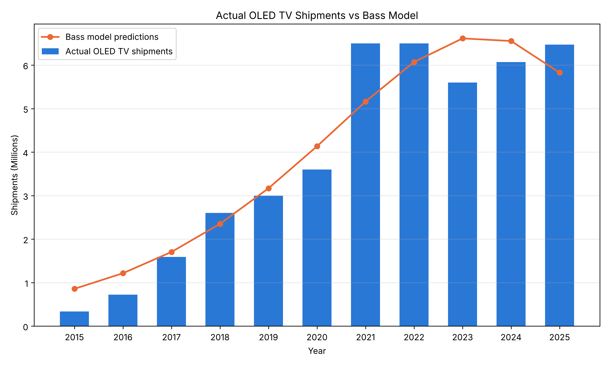
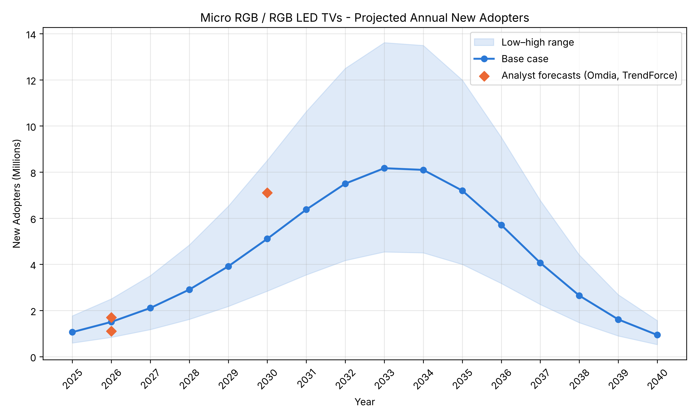
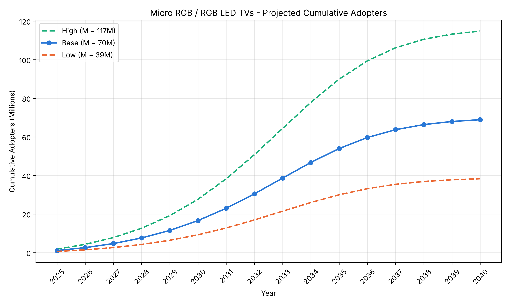

# Homework 1: Bass Diffusion Model

**Predicting the Diffusion of Samsung Micro RGB TVs Using Historical OLED TV Data**

Armen Petrosyan

## 1. Selected Innovation: Samsung Micro RGB

The innovation I chose is **Samsung Micro RGB**, which is on TIME's *Best Inventions of 2025* list (TIME, 2025):
https://time.com/collections/best-inventions-2025/7318277/samsung-micro-rgb/

Most premium LCD TVs use one white or blue backlight and then pass the light through color filters. Micro RGB replaces this backlight with a very dense grid of tiny red, green and blue LEDs (each under 100 micrometers) that are controlled individually, so the color is created directly by the light source. According to TIME, this gives richer and more accurate colors and uses about 20% less power. The first model was a 115-inch TV priced at $29,999 and it was released in 2025 (TIME, 2025).

The product became much more affordable very quickly. In December 2025 Samsung announced Micro RGB TVs in 55", 65", 75", 85", 100" and 115" sizes for 2026. In the US, the 55" model starts at $1,599.99 and the 65" R95H costs $3,199.99, which is actually a little cheaper than LG's 65" G6 OLED at $3,399.99. Other brands, mainly Hisense and TCL, are also investing in RGB LED TVs (ChannelNews, 2026). Because of this, I forecast the diffusion of **RGB LED / Micro RGB TVs as a product category**, with Samsung's Micro RGB as the product that started it.

## 2. Historical Look-Alike Innovation: OLED TVs

As a look-alike I chose the **OLED TV**. LG introduced it in 2013 and it started selling in meaningful volumes from 2015.

The two products are similar in several ways. Functionally, both are premium large-screen TVs that are sold mainly on picture quality (contrast, color, viewing angle) and not on new features, and both target the same customer: a household buying an expensive TV. Technologically, both change how light is produced at the pixel or zone level. OLED made every pixel produce its own light, and Micro RGB brings self-colored, finely controlled light sources to LCD. Both were marketed as "the next step" after regular LED-backlit LCD TVs. In terms of market impact, both started with very expensive, very large models and then moved down to 55–65 inch sizes within a few years. Today RGB LED TVs are being positioned directly against OLED, and Omdia expects RGB LED shipments (7.1 million) to be about the same as OLED shipments (about 6.9 million) by 2030 (Advanced Television, 2026; ChannelNews, 2026). This makes OLED's diffusion history the most relevant reference I could find.

There is also one important difference. For many years OLED TV panels came almost only from one supplier, LG Display, which kept supply limited and prices high. RGB LED TVs are built on existing LCD production lines, so their prices can fall faster (a 55" model was already $1,600 one year after launch). So it is possible that RGB LED TVs will spread faster than OLED did. I check this in Section 5.5.

## 3. Historical Data and Scope

### 3.1. Data

I use worldwide OLED TV shipments from 2015 to 2025, measured in millions of units. The numbers come from IHS Markit and Omdia (IHS Markit's technology research became Omdia in 2020, so the series comes from the same research group). I collected the yearly values from the press releases and articles that quote these firms:

| Year | OLED TV shipments (millions) |
|---|---:|
| 2015 | 0.335 |
| 2016 | 0.724 |
| 2017 | 1.59 |
| 2018 | 2.6 |
| 2019 | 3.0 |
| 2020 | 3.6 |
| 2021 | 6.5 |
| 2022 | 6.5 |
| 2023 | 5.6 |
| 2024 | 6.07 |
| 2025 | 6.47 |

For 2020 and 2022 I could not find the total directly, so I calculated it from LG's sales and its Omdia market share. Before 2015 sales were tiny (around 4,000 units in 2014), so I start the series in 2015. As a quick check, LG said it had shipped more than 15 million OLED TVs by 2022. With a market share of around 55–60%, this fits the total of my series up to 2022 (about 25 million).

I treat each TV shipped as one adopter (one household). This is not perfect because some people replace their TV, but TVs are replaced only every several years, so most shipments in this period should be first-time OLED buyers.

### 3.2. Scope

I chose a **worldwide** scope for three reasons:

1. Samsung sells the Micro RGB range in many countries (availability varies by country), and its main RGB LED competitors, TCL and Hisense, also sell globally (ChannelNews, 2026).
2. All the data I use is global: the OLED series, the RGB LED forecasts from Omdia and TrendForce, and the total TV market size. Country-level numbers are not publicly available, so a country-level model would need made-up inputs.
3. Using global data on both sides keeps p, q and M comparable.

There are regional differences (for example, Europe is OLED's biggest market with over 3 million units in 2025, according to LG Newsroom, 2026), but a global model averages these out.

## 4. Bass Model Estimation

The Bass model describes how many people adopt a new product in each period. It has three parameters:

- **p**: coefficient of innovation (people who adopt on their own)
- **q**: coefficient of imitation (people who adopt because others did)
- **M**: market potential (total number of eventual adopters)

I used the discrete-time version of the Bass model:

$$
N_t = \left(p + q\frac{A_{t-1}}{M}\right)(M - A_{t-1})
$$

where:

- **N_t** is the number of new adopters in year t.
- **A_(t-1)** is the cumulative number of adopters at the end of the previous year.
- **p**, **q** and **M** are the innovation coefficient, imitation coefficient and market potential.

I set cumulative adoption to zero before 2015, which is reasonable because OLED TV sales before 2015 were very small. The parameters were estimated in Python with nonlinear least squares (`scipy.optimize.least_squares`), which minimizes the squared differences between the actual yearly shipments and the model's predictions. All the code is in `bass_model.ipynb`.

### 4.1. Estimated Parameters

| Parameter | Estimate |
|---|---:|
| Coefficient of innovation (p) | 0.0151 |
| Coefficient of imitation (q) | 0.440 |
| Market potential (M) | 56.7 million |

q is about 29 times larger than p, which means OLED adoption was driven mostly by imitation and word of mouth (reviews, seeing the TV in stores or at friends' homes) and much less by people adopting independently. These values are close to the average values from the meta-analysis by Sultan, Farley and Lehmann (1990), p ≈ 0.03 and q ≈ 0.38. q is a bit higher, and p is lower, which makes sense for a very expensive product that people mostly bought after seeing others use it.

If the fitted model is continued after 2025, its peak is in 2023 at about 6.6 million units. In the real data, OLED reached its plateau of about 6 to 6.5 million per year from 2021, so the timing is close.

### 4.2. Model Performance

| Metric | Value |
|---|---:|
| RMSE | 0.64 million units |
| R² | 0.92 |

The model explains about 92% of the variation in yearly OLED shipments. It misses the jump in 2021 (when TV demand increased a lot during COVID) and the dip in 2023. Also, the Bass curve predicts that OLED sales will decline after 2025, while Omdia expects them to stay flat (ChannelNews, 2026). This probably means that replacement purchases and new OLED models keep sales up, so the real M for OLED is a bit higher than 57 million. This mostly affects M, and I only take p and q from OLED.

## 5. Predicting the Diffusion of Micro RGB / RGB LED TVs

### 5.1. Market Potential (Fermi Estimate)

For the new product I keep p and q from OLED and estimate a new M. Since there is no sales history yet, I used a Fermi-style estimate:

$$
M = \text{TV shipments per year} \times \text{RGB LED share} \times \text{life-cycle years}
$$

- **TV shipments per year:** 194.65 million, TrendForce's forecast for 2026 (TrendForce, 2026).
- **RGB LED share:** Omdia expects 7.1 million RGB LED TVs in 2030 (Advanced Television, 2026). 7.1 / 195 ≈ 3.6% of all TVs.
- **Life cycle:** OLED needed about 10 years (2015–2025) to go from its first real sales year to its plateau, so I assume RGB LED stays a leading premium option for about 10 years.

$$
M = 194.65 \times 0.036 \times 10 \approx 70 \text{ million TVs}
$$

Since the share and life-cycle numbers are assumptions, I also made a low and a high scenario:

| Scenario | RGB share | Life cycle | M (millions) |
|---|---:|---:|---:|
| Low | 2.5% | 8 years | 38.9 |
| Base | 3.6% | 10 years | 70.1 |
| High | 5.0% | 12 years | 116.8 |

The base value of 70 million is close to OLED's estimated M of 57 million. This makes sense because Omdia expects the two technologies to reach similar yearly volumes, and RGB LED TVs are cheaper.

### 5.2. Forecast Setup

| Parameter | Value |
|---|---:|
| p (from OLED) | 0.0151 |
| q (from OLED) | 0.440 |
| M (base) | 70.1 million |
| Start year (t = 1) | 2025 |

I start the forecast in 2025 because that is when the first Micro RGB TV was released (TIME, 2025), and I set cumulative adoption to zero at the start of 2025.

### 5.3. Predicted Number of Adopters

Worldwide new and cumulative adopters (millions of TVs):

| Year | New adopters (base) | Cumulative (base) | New (low) | New (high) |
|---|---:|---:|---:|---:|
| 2025 | 1.06 | 1.06 | 0.59 | 1.77 |
| 2026 | 1.50 | 2.56 | 0.83 | 2.50 |
| 2027 | 2.10 | 4.67 | 1.17 | 3.51 |
| 2028 | 2.90 | 7.57 | 1.61 | 4.84 |
| 2029 | 3.91 | 11.48 | 2.17 | 6.52 |
| 2030 | 5.11 | 16.59 | 2.84 | 8.51 |
| 2031 | 6.38 | 22.97 | 3.54 | 10.63 |
| 2032 | 7.50 | 30.47 | 4.17 | 12.50 |
| 2033 | 8.17 | 38.63 | 4.54 | 13.62 |
| 2034 | 8.10 | 46.73 | 4.50 | 13.49 |
| 2035 | 7.20 | 53.93 | 4.00 | 11.99 |
| 2036 | 5.71 | 59.63 | 3.17 | 9.51 |
| 2037 | 4.06 | 63.70 | 2.26 | 6.77 |
| 2038 | 2.65 | 66.34 | 1.47 | 4.41 |
| 2039 | 1.61 | 67.95 | 0.89 | 2.68 |
| 2040 | 0.94 | 68.89 | 0.52 | 1.56 |

In the base case, yearly adoption grows from about 1.5 million in 2026 to about 5.1 million in 2030 and peaks in **2033 at about 8.2 million TVs**. After that it goes down as the market gets saturated. Cumulative adoption reaches about 17 million by 2030 and 54 million by 2035, and gets close to the 70 million limit around 2040. In the low and high scenarios the peak is also in 2033 (4.5 and 13.6 million), because the timing of the peak depends only on p and q, not on M.

If Samsung keeps its overall TV market share of about 18.8% (17.6 million of 93.74 million TVs in the first half of 2026, TrendForce, 2026), it would sell about 0.28 million Micro RGB TVs in 2026 and about 1.5 million per year at the peak. Since Samsung was first in this category, its real share of RGB TVs is probably higher in the early years.

### 5.4. Adoption Forecast Visualizations

### 5.5. Comparison with Analyst Forecasts

To check whether the forecast is reasonable, I compared it with forecasts from two market research firms. These numbers were not used to fit the model.

| Year | Analyst forecast | Source | My model (base) |
|---|---:|---|---:|
| 2026 | 1.1 million | Omdia | 1.50 million |
| 2026 | 1.7 million | TrendForce | 1.50 million |
| 2030 | 7.1 million | Omdia | 5.11 million |

For 2026, my estimate is between the Omdia and TrendForce numbers. For 2030, my model is about 30% lower than Omdia. This supports the idea from Section 2 that RGB LED could spread faster than OLED did. When I solved for the q that gives Omdia's 7.1 million in 2030 (keeping p and M the same), I got **q ≈ 0.56**. With this q the 2026 value is 1.63 million (still between the two analyst forecasts) and the peak moves one year earlier, to 2032 at about 10.2 million. So I think q between 0.44 and 0.56 is a reasonable range for this product, and my base forecast is the more conservative one.

## 6. Limitations

- The p and q values come from a different product. RGB LED TVs are cheaper to make than OLED TVs were, so their adoption could be faster (Section 5.5).
- Two of the OLED values (2020 and 2022) are calculated from LG's sales and market share, and some of the yearly values are taken from news articles quoting IHS Markit and Omdia, not from the original reports.
- Shipments are not exactly the same as unique adopters, because some buyers replace or add TVs.
- The model starts with zero cumulative adopters in 2015 for OLED and in 2025 for RGB LED. For OLED this ignores the small number of TVs sold in 2013–2014.
- The forecast for 2025 (1.06 million) is probably too high. In 2025 only the $30,000 115-inch model was available, so the real mass-market start is 2026.
- The market potential is a Fermi estimate based on assumptions about the RGB share and the life cycle. The low and high scenarios show how much the results depend on these assumptions.
- The Bass model assumes M, p and q stay constant and does not include price changes, marketing, competition from OLED and Mini LED, or new product generations.

So the results should be seen as a reasonable scenario, not an exact prediction of sales.

## 7. Conclusion

In this homework I used the Bass diffusion model to forecast the worldwide adoption of Samsung Micro RGB / RGB LED TVs, using OLED TVs as a look-alike. The discrete Bass model fitted OLED shipments from 2015 to 2025 well (R² = 0.92) and gave p = 0.0151, q = 0.440 and M = 56.7 million. Using these p and q values and a Fermi estimate of about 70 million for the new market, the model predicts that RGB LED TV adoption will peak around 2033 at about 8.2 million TVs per year, with about 17 million adopters by 2030 and 54 million by 2035.

The forecast is close to analyst forecasts for 2026 but lower than Omdia's forecast for 2030, which suggests that RGB LED TVs may spread somewhat faster than OLED did. Overall, the analysis shows that a similar past product can give a useful starting point for forecasting a new one, as long as the assumptions are clear.
